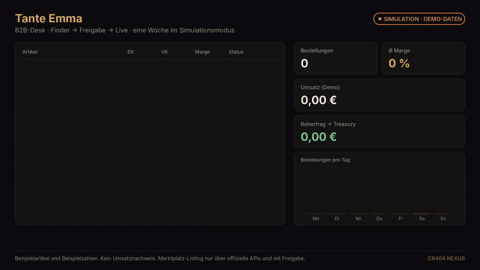

  

<h1 align="center">CR404 NEXUS</h1>

  <strong>Automatisierung, die fragt, bevor sie Geld kostet.</strong> 
  Fünf Geschäfte. Ein Cockpit. Jedes Modul auch einzeln.

  
  
  
  

  <a href="#in-30-sekunden">In 30 Sekunden</a> ·
  <a href="#sieh-selbst">Demos</a> ·
  <a href="#die-fuenf">Die fünf</a> ·
  <a href="#einzeln">Einzeln kaufbar</a> ·
  <a href="#inventur">Was steht</a> ·
  <a href="#kapital">Wohin Kapital geht</a> ·
  <a href="docs/INVESTORS.en.md">English</a>

---

## In 30 Sekunden

**Das Problem.** Wer ein kleines Geschäft automatisieren will, landet bei zwölf Abos und einem Bot, dem er nicht traut.
Shop hier, Trading-Tool da, ein KI-Agent, der nachts irgendetwas tut. Niemand sieht die Gesamtzahl. Niemand hat den Not-Aus.

**Die Antwort.** CR404 NEXUS ist das Betriebssystem für kleine, automatisierbare Geschäfte.
Laden, Markt-Desk, Wächter, App-Fabrik und Studio hängen an **einem Cockpit** und rechnen auf **eine Kasse**.

**Der Unterschied.** Alles, was Geld oder Ruf kosten kann, ist bei uns ein **Entwurf, bis ein Mensch freigibt**: Listings, Deploys, Echtgeld-Orders.
Für einen vorsichtigen Kunden ist das kein fehlendes Feature. Es ist der Grund, warum er überhaupt einsteigt.

  
   Dagobert Market, Taktik-Backtest. <b>Simulation mit Demo-Daten</b>, keine Renditeaussage. <a href="media/demo/dagobert-backtest-demo.mp4">MP4 in HD</a>

---

## Sieh selbst

Zeigen statt behaupten. Beide Clips laufen im Simulationsmodus des Cockpits, die Zahlen sind Beispielwerte und im Bild dauerhaft so beschriftet.

| Tante Emma: vom Fund zum freigegebenen Listing | Dagobert Market: erst Papier, dann Freigabe |
| --- | --- |
|  |  |
| Artikel finden, Marge sehen, Mensch gibt frei, Bestellungen laufen in die Kasse. [MP4](media/demo/tante-emma-desk-demo.mp4) | Taktik gegen Buy-and-Hold, Drawdown sichtbar, Echtgeld verriegelt. [MP4](media/demo/dagobert-backtest-demo.mp4) |

  

---

## Warum das hält

Die meisten „Super-Apps“ sind ein Dashboard mit zu vielen Tabs.
NEXUS ist anders geschnitten: **die Grenzen sind schon Repos.**

| | |
| --- | --- |
| **Suite oder Einzelstück** | Ein Händler nimmt Tante Emma und lässt den Krypto-Desk liegen. Ein Builder nimmt nur Forge. Die Suite ist das Upsell, nicht die Eintrittskarte. |
| **Eine Kasse** | Was die Module verdienen, landet im Cockpit in einer Treasury. Heute als ehrliches Modell. Morgen als echte Buchung, sobald Mandant und Lizenzfrage geklärt sind. |
| **Der Mensch bleibt im Loop** | Listings, Deploys und Echtgeld-Orders sind Entwürfe, bis jemand freigibt. Vertrauen ist hier das Feature. |
| **Keys sind optional** | Das Cockpit läuft ohne API-Schlüssel. Schlüssel schalten Live-Kurse, Börsen-Guthaben und die KI frei. Sie sind nicht die Krücke, an der alles hängt. |
| **Kein stiller Bot mit Kundengeld** | Dagobert ist ein Entscheidungs- und Simulationscockpit. Echtgeld sitzt hinter einem Gate. Schlüssel gehören auf den Server, nie in den Browser. |

Der Reiz für einen Investor ist nicht „noch ein Agent“.
Der Reiz ist ein **Baukasten mit eigenen Märkten**, der sich Modul für Modul finanzieren lässt, ohne die Suite zu zerlegen.

---

## Die fünf

| Modul | In einem Satz | Allein lebensfähig | Heute |
| --- | --- | --- | --- |
| [RoboCop404](#robocop404) | Der Wächter. Start, Stopp, Audit, Circuit Breaker. | Ja, als Ops- und Security-Modul | Cockpit plus schlankes Security-Modul |
| [Tante Emma](#tante-emma) | Der Laden. B2C-Shop und B2B-Dropshipping mit Freigabe. | Ja | Fläche und Modell stehen, Marktplätze sind Skelette |
| [Dagobert Market](#dagobert-market) | Der Desk. Signale, Paper-Trade, Backtest. Krypto zuerst. | Ja | Dashboard läuft, Echtgeld ist verriegelt |
| [Forge](#forge) | Die Fabrik. Aus einem Satz wird eine lauffähige App. | Ja | Pipeline baut, testet und committet lokal |
| [Music Video Studio](#music-video-studio) | Das Studio. Track, Bild, Clip aus einem Prompt. | Ja, sobald der Generator steht | Platz im Cockpit, Generator ist der nächste Bau |

Dazu, leiser, aber schon geschnitten: **AL Messenger** (Chat für Shop, Support und Agenten), die **B2B-Arbitrage-Engine** (Discovery, SEO, Freigabe vor dem Listing) und **CR404 Shops** (die Verkaufsseiten, aus denen Tante Emma das Sortiment zieht). Sie sind Zulieferer der fünf, keine sechste Story.

Ausführlich, für jemanden, der nur ein Modul will: die Seiten unter [`docs/`](docs/).

---

## RoboCop404

  

**Teams, die Agenten laufen lassen, kaufen nicht „mehr Intelligenz“. Sie kaufen jemanden, der den Stecker zieht.**

- Übernimmt Strategien, die woanders entworfen wurden, etwa aus dem Taktik-Regal von Dagobert, und lässt sie in einer Schleife laufen.
- Start und Stopp. Kippt das Risiko, zieht er den **Circuit Breaker**. Lieber still als teuer.
- Darunter ein regelbasiertes Security-Modul ohne Sprachmodell und ohne externe Abhängigkeit: System- und Secret-Audit (nur lesen), Stacktrace-Analyse mit Empfehlung, Deployment nur als **Entwurf**.

Allein ist RoboCop404 ein Ops-Modul. In der Suite ist er das Schloss an Dagobert, Forge und dem Shop.
→ [`docs/robocop.md`](docs/robocop.md)

---

## Tante Emma

  

**Der Laden an der Ecke, der nebenbei Großhandel kann.** Zwei Geschäfte, eine Theke.

- **B2C:** Sortiment, Warenkorb, Kasse, Bestellhistorie. Verkaufen, ohne eine Agentur für einen Warenkorb zu bezahlen.
- **B2B und Dropshipping:** Artikel finden, Einkauf gegen Verkauf legen, Marge sehen, SEO-Text erzeugen, Listing-Vorschau, Bestellung, Tracking, Kasse.
- **Marktplätze als Richtung:** Amazon, eBay, Shopify, Etsy, Kaufland. **Immer über offizielle APIs. Immer mit menschlicher Freigabe vor dem Listing.**

  
   Simulation mit Beispielartikeln und Beispielzahlen. Kein Umsatznachweis.

**Ehrlich zum Stand:** Finder, Artikel, Vergleich, Bestellungen, Tracking, Kasse und lokaler Shop stehen. Katalog, Warenkorb und SEO sind als Backend angelegt. Die Marktplatz-Publisher sind Skelette, kein Autopilot, der nachts auf Amazon listet. Genau das will ein vernünftiger Händler auch nicht.
→ [`docs/tante-emma.md`](docs/tante-emma.md)

---

## Dagobert Market

  

**Eine Meinung zum Markt, bevor man eine Order will.** Krypto zuerst, daneben Aktien, Rohstoffe, Forex, Edelmetalle.

- **Signale** mit Begründung, kein Ampel-Kult. Marktübersicht, Charts, Indikatoren.
- **Paper-Trade:** Startkapital, Orders, Positionen, Gewinn und Verlust. Alles auf Papier, sofort benutzbar.
- **Taktiken:** SMA, EMA, RSI, MACD, Bollinger, Momentum, Grid und Kombinationen. Jede mit Backtest gegen Buy-and-Hold und Equity-Kurve. Was besteht, geht an RoboCop404.
- **Daten:** CoinGecko ohne Schlüssel, FRED für Makro, Kraken und Binance nur lesend und nur serverseitig. KI nur über das Backend.

**Was es nicht ist:** keine Börse, kein Broker, keine Lizenzbehauptung, keine Rendite. Echtgeld-Orders laufen nur über einen eigenen serverseitigen Endpunkt **und** nach ausdrücklicher Bestätigung.
→ [`docs/dagobert-market.md`](docs/dagobert-market.md)

---

## Forge

  

**Software auf Zuruf. Nicht als Folie, als Projekt.**

| Rolle | Aufgabe |
| --- | --- |
| **Architect** | Aus dem Satz wird Struktur und Stack. |
| **Builder** | Frontend und Backend. Echte Routen, keine Attrappe. |
| **Styler** | Layout, das man anfassen kann. |
| **Tester** | Startet, was gebaut wurde, und prüft, ob es antwortet. |
| **Shipper** | Lokales Git-Commit. Push nur auf ausdrücklichen Befehl. |

**Ehrlich zum Stand:** „Bau eine Landingpage für …“ erzeugt lauffähigen Code, startet das Backend und committet lokal. Der Styler hat noch ein festes Theme. Nichts veröffentlicht sich selbst.
→ [`docs/forge.md`](docs/forge.md)

---

## Music Video Studio

  

**Ton und Bild aus einem Auftrag, nicht aus zwölf Abos.** Track, Loop, Stem, dazu Visualizer, Lyric-Video, Clip.

**Ehrlich zum Stand:** Architektur und Platz im Cockpit stehen. Die Generator-Anbindung ist der nächste Bauabschnitt. Wer heute investiert, investiert in die Strecke vom Prompt zur Datei, nicht in einen vorgetäuschten Hit.
→ [`docs/musicvideo-studio.md`](docs/musicvideo-studio.md)

---

## Einzeln

Man muss die Suite nicht wollen.

| Wenn du nur das brauchst | Nimmst du | Und lässt liegen |
| --- | --- | --- |
| Einen Laden plus Dropshipping mit Freigabe | Tante Emma | Desk, Studio, Forge |
| Einen Markt-Desk mit Paper-Trade | Dagobert Market | Shop, Studio |
| Jemanden, der Agenten beaufsichtigt | RoboCop404 | alles andere |
| Software aus einem Satz | Forge | Handel und Shop |
| Tracks und Clips | Music Video Studio | den Rest |
| Nur Chat, Support, Channels | AL Messenger | die Geschäfte |
| Nur Produktsuche, SEO, Listing-Freigabe | B2B-Arbitrage | den Laden drumherum |
| Nur die Verkaufsseiten | CR404 Shops | den B2B-Desk |

Jedes Modul hat einen eigenen Namensraum. Der Kleber in der Suite ist bewusst langweilig: ein gemeinsamer Zustand, ein Event-Bus, eine Treasury, ein Schalter pro Modul.
→ [`docs/standalone.md`](docs/standalone.md)

---

## Wer kauft

- **Der Händler** will Marge sehen und nicht blind listen. → Tante Emma.
- **Der Trader** will Meinung, Backtest und Not-Aus, bevor er eine Börse anfasst. → Dagobert plus RoboCop404.
- **Die Agentur oder der Gründer** will aus einem Satz eine Fläche, die hochfährt. → Forge.
- **Der Creator** will Ton und Bild aus einem Auftrag. → Studio, sobald die Generatoren stehen.
- **Der Betreiber** will alles auf einem Schirm und eine Zahl, die sagt, was die Teile zusammen tragen. → NEXUS.

---

## Inventur

Nicht als Versprechen. Als Bestandsliste.

- Browser-Cockpit für NEXUS: Launcher, Treasury, Wallet, Ideen-Cockpit, Autopilot als Simulation, alle Module anklickbar.
- Neun fachliche Agenten im Kern: Nischen, Startups, Bitcoin-Signal, Rohstoffe, Portfolio, Datenbündelung, Code-Qualität, Security-Scan, Affiliate- und B2B-Entwürfe. Reports als JSON und Markdown. Ein Agent, der scheitert, reißt den Lauf nicht mit.
- RoboCop404 als Fläche plus regelbasiertes Security-Modul mit Freigabe vor dem Deploy.
- Tante Emma als Shop- und B2B-Fläche, Backend angelegt, Messenger angedockt.
- Dagobert Market als Trading-Dashboard mit Paper-Trade, Taktik-Backtest und verriegeltem Echtgeld.
- Forge als Pipeline, die wirklich baut, startet und lokal committet.
- AL Messenger als eigenständiger Chat mit Räumen, Presence und WebSocket-Hub.
- Music Video Studio als Architektur und Cockpit-Platz.

| Noch Skelett | Warum das okay ist |
| --- | --- |
| Marktplatz-Publisher (Tante Emma) | Erst ein Händler, ein Marktplatz, ein freigegebenes Listing. Dann skalieren. |
| Studio-Generator | Die Strecke Prompt → Datei ist der nächste Bau, nicht ein Knopf. |
| Mandanten-Kasse (NEXUS) | Heute lokal und ehrlich simulierbar. Der Sprung ist Betrieb, nicht Architektur. |

---

## Kapital

Dieses Repository ist kein Term Sheet und keine Runde. Es ist die Landkarte, worauf Geld arbeiten würde.

1. **Tante Emma zu Ende bringen.** Ein Händler, ein Marktplatz, ein Listing, das ein Mensch gesehen hat. Dann der zweite.
2. **Dagobert sauber halten.** Bessere Daten, nachvollziehbare Backtests, das Echtgeld-Gate juristisch und technisch langweilig machen.
3. **Forge wiederholbar machen.** Ein Theme pro Auftrag. Eine Auslieferung, die ein Kunde ohne den Autor startet.
4. **Studio: Prompt zu Datei.** Eine Generator-Strecke, eine Warteschlange, eine Ablage. Ein Clip, den man abspielt.
5. **NEXUS: ein Mandant.** Login, echte Kasse, getrennte Kunden.

Wer nur ein Modul finanzieren will, kann das. Die Repos sind schon getrennt.
Wer die Hülle finanziert, finanziert den Kleber und die Kasse, nicht noch einmal jedes Geschäft.

---

## Was bewusst nicht hier liegt

Kein Anwendungscode. Keine Abhängigkeiten. Keine Schlüssel. Keine `.env`. Keine Kopie der Arbeitsrepos.
Dieses Repo ist das Schaufenster. Die Werkstatt bleibt privat. Zugang zur Implementierung gibt es im Gespräch.

---

## Gespräch

Investoren, Händler, Partner: **[@arondakoa](https://github.com/arondakoa)** auf GitHub.
Englische Kurzfassung: [`docs/INVESTORS.en.md`](docs/INVESTORS.en.md)

---

## Rechte

© 2026 arondakoa (CR404). **Alle Rechte vorbehalten.** Keine Open-Source-Lizenz.
Ansehen und verlinken ja. Kopieren, Weiterverwenden, Nachbauen der Texte, Bilder und Videos oder Nutzung der Produktnamen nur mit schriftlicher Zustimmung. Text- und Data-Mining sowie KI-Training sind vorbehalten.
Volltext: [`LICENSE`](LICENSE) · Hinweise: [`NOTICE.md`](NOTICE.md)

Kein Angebot von Wertpapieren. Keine Anlageberatung. Keine Einladung, Geld zu überweisen.
Handel und Krypto können auf null gehen. Ob ein Modul eine Erlaubnis braucht, hängt vom Land ab und davon, ob fremdes Geld bewegt wird. Stand dieses Dossiers ist Dagobert ein Simulations- und Entscheidungscockpit mit gesperrtem Echtgeld-Pfad.
Demo-Videos zeigen Beispieldaten im Simulationsmodus. Markenstills sind Stimmung, nicht die ausgelieferte Oberfläche.
RoboCop404 ist ein eigener Produktname und kein Bezug auf einen Film.

