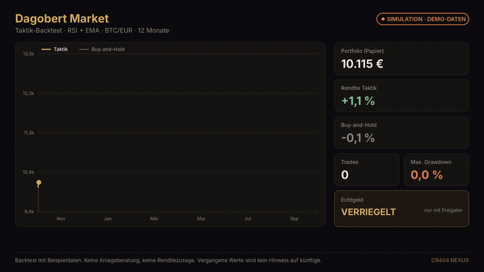

# Dagobert Market

Taktik-Backtest im Simulationsmodus. Demo-Daten, keine Renditeaussage. [MP4](../media/demo/dagobert-backtest-demo.mp4)

Der Schreibtisch für Märkte.
Krypto zuerst. Aktien, Rohstoffe, Forex und Edelmetalle im selben Blick.

Der Name ist eine Haltung: eine Kasse, die man zählen kann.
Er ist keine Figur, kein Comic, keine Börse.

## Was der Desk kann

- **Signale.** Kaufen, halten, verkaufen. Mit Grund. Ein Bitcoin-Lauf holt sich den öffentlichen Kurs und fällt bei Netzausfall auf einen Ersatzkurs zurück, statt zu sterben.
- **Überblick.** Märkte nebeneinander, nicht in zehn Tools.
- **Portfolio und Paper-Trade.** Startkapital, Orders, Positionen, Gewinn und Verlust. Alles auf Papier, sofort benutzbar.
- **Taktiken.** SMA, EMA, RSI, MACD, Bollinger, Momentum, Grid, Kombinationen, passive Varianten. Backtest mit Rendite, Trade-Anzahl, Vergleich zu Buy-and-Hold und einer Equity-Kurve.
- **Übergabe.** Eine Taktik, die den Test übersteht, kann an RoboCop404 gehen. Der Wächter läuft die Schleife und hat den Not-Aus.
- **KI.** Nur über das Backend. Der Schlüssel sieht den Browser nie.
- **Wallet, nur lesen.** CoinGecko ohne Schlüssel. Makrodaten, wo ein Schlüssel liegt. Börsen-Guthaben von Kraken oder Binance nur serverseitig, nur lesend.

## Echtgeld

Echtgeld ist ein Gate, kein Modus, den man aus Versehen antippt.
Orders gehen nur raus, wenn ein eigener serverseitiger Endpunkt hinterlegt ist und der Handel ausdrücklich bestätigt wurde.
Schlüssel liegen nicht im Frontend. Nie.

Dagobert verwahrt kein Kundengeld. Dagobert ist kein Broker.
Ob ein späterer Live-Pfad eine Erlaubnis braucht, ist eine Frage des Landes und der Konstruktion, nicht ein Satz in einem README.
Bis das geklärt ist, bleibt der Pfad zu.

## Allein

Ein Trader oder ein Family-Office-artiges Kleinteam kann den Desk nehmen, ohne den Laden und ohne das Studio.
React-Dashboard, Paper-Trade, Signale, Backtest.
Fehlt das Backend, arbeitet die Fläche mit Simulationsdaten weiter. Man kann sie jemandem zeigen, ohne eine Börse anzuschließen.

## In der Suite

Er ist der Marktarm.
Die Treasury des Cockpits kennt seine Ergebnisse als Teil des Gesamtbildes, neben Shop und Studio.
Das ist die Produktidee einer gemeinsamen Bilanz. Es ist keine ausgewiesene Performance und keine Vermögenszahl, mit der man werben dürfte.

Neben dem Desk arbeiten im Kern von NEXUS noch die ruhigeren Finanz-Agenten: Nischenmärkte, Startup-Bewertung, Rohstoffe, Portfolio-Aufteilung, eine Bündelung, die weiterläuft, wenn ein einzelner Agent scheitert.
Die schreiben Reports. Sie traden nicht.

## Stand

Dashboard, Signale, Paper-Trade, Taktik-Backtest, lesende Kursquelle: benutzbar.
Echtgeld: verriegelt.
Renditeversprechen: gibt es nicht.

[Zurück zum Dossier](../README.md)
